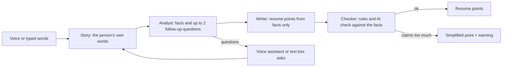

# AI Resume Builder

Talk about your work out loud; get a resume where **every line traces back to something you actually said**.

You describe a job or project by voice (or typing). A small AI team turns your words into facts,
writes the points, and checks them, and nothing is invented. Built as a portfolio project for
forward-deployed-engineer roles, for tech professions first.

<!-- DEMO GIF: add docs/media/demo.gif in the final local session and embed it here with  -->

> Demo GIF and screenshots: coming (taken in the final local session).

## Why this is hard

- **Voice in, structure out.** A live voice assistant edits a structured resume only through validated tools, never by free text.
- **Nothing invented.** The AI writes only from facts taken from the person's own words; an exaggerated line is caught and simplified.
- **Traceable.** Each point links to the facts behind it, and each fact to the person's words (kept private, never shown on screen).
- **Honest about doubt.** Points the checker is unsure about show a warning but never block saving or downloading.
- **Safe to put online.** Daily limits per visitor, then bring your own key (kept only in the browser tab).

## The writing team



The voice assistant ends the call by itself when its step is done; the writing team runs in the
background after an entry is captured, with a "Rewrite points" button to run it again.

## Evaluation

- **Offline cases** (`python evals/run_evals.py`, no key, no database, no network): they prove the
  rules of the system, e.g. a hand edit clears a warning, only the person's words are stored, the daily
  limit counts and resets, a visitor's own key is never stored or logged, and no voice action
  makes a hidden AI call. Full list: [evals/README.md](./evals/README.md).
- **Writing test set** ([evals/writing/README.md](./evals/writing/README.md)): fictional stories
  covering hard cases (rambling, "we" versus "I", no numbers, many numbers, two projects mixed,
  very short answers, imperfect English, spoken numbers, tool nicknames) plus trap points where an
  honest line is paired with an exaggerated one. It measures invented claims against a saved baseline.
  It calls a paid model, so it only runs on purpose.

## Limits and bring your own key

Each visitor (logged-in user, else session) has small daily limits per kind of AI use, set in
`api/.env.example` (`DAILY_LIMIT_*`). Past the limit the site says when it resets and offers a box
to paste your own OpenAI key. The key stays in `sessionStorage`, is sent in a header for that
request only, is never stored or logged on the server, and those requests are not counted.

## Tech stack

FastAPI (Python) · Postgres 16 · OpenAI (text and Realtime voice) · React 19 + Vite + TypeScript.

<!-- Screenshots: add the intake, editor and "Tailor to a job" images to docs/media/ and link them here. -->

**North star:** [docs/V2.md](./docs/V2.md)

## Start here

| Doc | Purpose |
|-----|---------|
| [docs/V2.md](./docs/V2.md) | Project direction — structured ops, versioning, provenance, eval |
| [docs/ORCHESTRATOR.md](./docs/ORCHESTRATOR.md) | Mutation pipeline — tools-only writes, policy |
| [docs/resume-payload.md](./docs/resume-payload.md) | Resume JSON payload shape (v5) |
| [evals/README.md](./evals/README.md) | Evaluation harness |

## Layout

```text
api/     FastAPI — mutation pipeline, versioning, JD analysis
web/     Vite + React — intelligence panel, variants, preview
evals/   Deterministic + LLM evaluation cases
docs/    Architecture and payload contract
```

## V2 pipeline

```text
Text (or voice→STT) → LLM proposes CareerOperations
                   → validate (schema, entities, ambiguity)
                   → execute (resume_ops)
                   → version log + facts/claims
                   → resume variant / preview
```

## Run locally

```bash
# Everything at once: database, API and website (Ctrl+C stops them; KEEP_DB=1 keeps the database up)
bash scripts/dev.sh
```

Or step by step:

```bash
# Database (Postgres 16 in Docker, data kept in the resume-builder-db-data volume)
docker compose up -d

# API (needs the database and OPENAI_API_KEY in api/.env; see api/.env.example)
# Creates any missing tables on startup.
cd api && uvicorn main:app --reload --port 8081

# Frontend
cd web && npm run dev

# Evals (no database or API key needed)
python evals/run_evals.py

# Walkthrough against a real, separate test database (needs the database running;
# --no-ai skips the two paid AI calls)
python evals/db_walkthrough.py --no-ai
```

## Key API endpoints

| Endpoint | Purpose |
|----------|---------|
| `POST /resume/{id}/mutate` | NL → structured ops → validated mutation |
| `GET /resume/{id}/versions` | Version history |
| `POST /resume/{id}/versions/{n}/restore` | Restore snapshot |
| `POST /resume/{id}/analyze-jd` | JD analysis + job variant |
| `POST /resume/{id}/retrieve` | Structured evidence retrieval |
| `GET /resume/{id}/claims/{id}/provenance` | Claim → fact trace |
